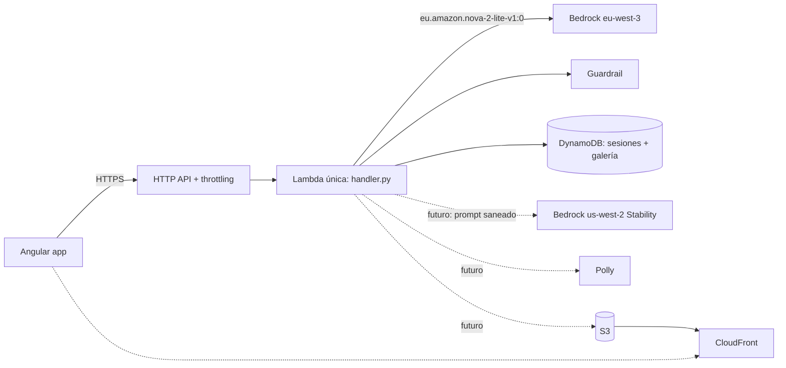

# Design: Nightmare Resolver

Principio: lo más simple que funcione. Una Lambda, funciones sueltas, sin pydantic y sin capas de inyección de dependencias.

## Architecture



Base region: `eu-west-3` (París). En `eu-south-2` la cuenta nueva tenía las cuotas de Bedrock a 0. Solo la generación de imágenes (futura) llama a `us-west-2`.

Rutas (una sola Lambda enruta por `routeKey`):

| Ruta | Función |
|---|---|
| `POST /sessions` | `story.start(nightmare, language)` |
| `POST /sessions/{session_id}/steps` | `story.next_step(session_id, choice_id)` |
| `POST /sessions/{session_id}/publish` | `gallery.publish(session_id, consent)` |
| `GET /gallery?language=&limit=&cursor=` | `gallery.list_stories(language, limit, cursor)` |
| `DELETE /gallery/{story_id}` (cabecera `x-delete-token`) | `gallery.delete(story_id, token)` |
| futura: `speak` | función nueva o fichero propio |

## Components

### Backend (Python 3.12, `backend/src/nightmare/`)

| Fichero | Contenido |
|---|---|
| `handler.py` | Entrada de la Lambda: enruta, lee el body, traduce errores a HTTP |
| `story.py` | `start()` y `next_step()` |
| `gallery.py` | `publish()` (anonimizar con Nova, guardrail de salida, token), `list_stories()`, `delete()` |
| `ai.py` | `ask(system, user, parse)`: Converse a Nova, extrae JSON, valida con `parse`, un reintento |
| `safety.py` | `classify()` (guardrail + clasificador) y `output_is_safe()` |
| `db.py` | `save`, `load`, `delete` de sesiones; `put_story`, `get_story`, `delete_story`, `query_stories` de la galería |
| `models.py` | Constantes del arco, `Step` (con `from_dict` que valida), `Session`, `Category`, `ApiError` |
| `prompts.py` | Plantillas de prompts |
| `messages.py` | Mensajes de parada y recursos de ayuda |

Reglas de diseño:
- Los clientes boto3 son variables de módulo (Lambda los reutiliza). No hay caché ni `wiring`.
- Configuración con variables de entorno leídas al inicio del módulo.
- Un único error propio, `ApiError(status, code)`. Los `ClientError` de AWS se mapean en el handler (429 si es throttling, 503 en otro caso). Cualquier otra excepción es 500 sin detalles.
- Validar la salida del modelo es una función (`Step.from_dict`), no un framework.

### Frontend (Angular, `frontend/`)
- Vistas por hash, sin router: inicio (historia), `#/gallery` y `#/delete/<id>/<token>`. El fragmento no llega a ningún servidor, así que el token no queda en logs.
- Estado con signals; i18n ES/EN; reproductor con subtítulos; `prefers-reduced-motion`.

### Infra (CDK Python, `infra/`)
- `stacks/nightmare_stack.py`: tabla, Lambda, IAM y HTTP API en un solo stack.
- `stacks/guardrail.py`: guardrail y su versión.
- El código se sube con `Code.from_asset("backend/src")`. Sin Docker ni dependencias propias (boto3 ya viene en Lambda).
- Lambda ARM64, 512 MB, 29 s. API con límite global de 5 req/s (ráfaga 10) y CORS configurable con `-c allowedOrigins=[...]`.
- IAM mínimo: `InvokeModel` solo sobre el perfil UE de Nova y el modelo en regiones `eu-*`; `ApplyGuardrail` solo sobre nuestro guardrail; lectura/escritura solo sobre la tabla.

## Data model (DynamoDB)

- Sesión: `pk = SESSION#<id>`, `ttl` (24 h), `data` (JSON de `Session`: `language`, `summary`, `history[]`, `chosen[]`).
- El texto original de la pesadilla solo existe en memoria durante la petición. Se guarda un resumen anónimo.
- Historia publicada (misma tabla, sin cambiar la clave): `pk = STORY#<id>`, `id`, `language`, `created_at`, `token_hash` (SHA-256 del token), `story` (JSON de los pasos anonimizados: `step`, `title`, `narration`, `learning`, `coping_tip`, `has_image`, `image`), `ttl` opcional (90 días por defecto, `GALLERY_TTL_DAYS`, `0` = permanente) y las claves del índice `gpk = GALLERY#<idioma>`, `gsk = <created_at con 12 dígitos>#<id>`.
- Índice secundario `gallery` (`gpk`, `gsk`) con proyección INCLUDE `[id, language, created_at, story, ttl]`: listar nunca puede devolver `token_hash`. Se usa un GSI en lugar de `pk = GALLERY` + `sk` porque añadir una clave de ordenación obligaría a reemplazar la tabla.

## Story step JSON contract

```json
{
  "step": 1,
  "title": "string",
  "narration": "string (<=120 words)",
  "choices": [{"id": "a", "label": "string"}],
  "image_prompt": "string (generic, no personal data) or null; only steps 1 and 4 have one",
  "technique": "recreate|control|decision|rewrite|closing",
  "learning": "string|null",
  "coping_tip": "string|null"
}
```

`Step.from_dict` comprueba: técnica según el paso, 2-3 opciones con ids únicos (ninguna en el cierre), `learning` y `coping_tip` en el cierre, `image_prompt` en los pasos 1 y 4, máximo de palabras.

Respuestas de la API:

```json
{"status": "ok", "session_id": "...", "step": {}, "finished": false}
{"status": "stopped", "category": "risk|not_serious|forbidden_content", "message": "...", "resources": []}
{"status": "ok", "story_id": "...", "delete_token": "...", "expires_at": 1700000000}
{"stories": [{"id": "...", "language": "es", "created_at": 0, "steps": []}], "next_cursor": "...|null"}
{"error": "language|nightmare_length|choice|body|session_not_found|session_finished|generation_failed|busy|unavailable|internal|not_found|consent|session_not_finished|already_published|not_publishable|limit|cursor"}
```

## Moderation flow

1. Guardrail sobre la entrada. Si salta el tema `SelfHarm` → `risk` directamente.
2. Clasificador de Nova (`ok | not_serious | forbidden_content | risk`). `risk` siempre gana.
3. Si el guardrail bloqueó y el clasificador no dijo `risk` → `forbidden_content`.
4. Cada paso generado pasa por el guardrail de salida. Si falla, se borra la sesión y se para.
5. Las elecciones son botones: validar el `id` contra las opciones del paso es su moderación.
6. Publicar en la galería: Nova reescribe la historia quitando datos identificativos y el texto anonimizado vuelve a pasar por el guardrail de salida. Si falla, `422 not_publishable` y no se guarda nada.
7. Futuro: moderar el prompt de imagen antes de enviarlo a `us-west-2`.

## Error handling

- JSON inválido del modelo: un reintento y después `502 generation_failed`.
- Throttling de Bedrock: `429 busy`.
- Fallo de imagen (futuro): placeholder, la historia continúa.
- Fallo de moderación a mitad de historia: se acaba la sesión y no se guarda nada.

## Testing strategy

- `backend/tests/test_app.py`: pytest con fakes de `ai.ask`, `db` y `safety` (arco, paradas, historia completa, rutas y errores del handler).
- `infra/tests/test_stack.py`: aserciones sobre la plantilla (una Lambda, rutas, TTL, permisos, guardrail, CORS) y `cdk synth` en CI.
- Pendiente: corpus de entradas reales para el clasificador, ejecutado a mano contra Bedrock.
- Angular: tests unitarios del flujo de la historia.
