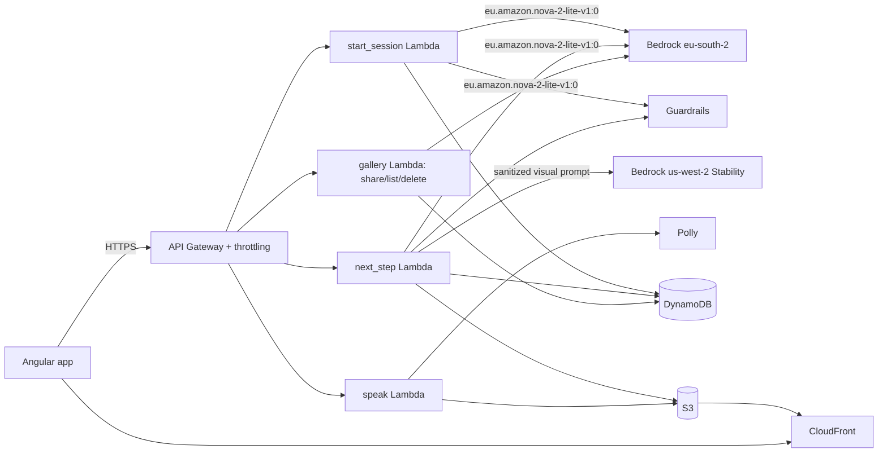

# Design: Nightmare Resolver

## Architecture



Base region: `eu-south-2`. Only image generation calls `us-west-2`.

## Components

### Backend (Python 3.12, `backend/`)
- `shared/models.py`: pydantic schemas (Step, Session, Classification, GalleryItem).
- `shared/bedrock.py`: Converse wrapper for Nova 2 Lite with JSON output, one retry on invalid JSON.
- `shared/moderation.py`: Guardrails + LLM classifier returning `ok | not_serious | forbidden_content | risk`.
- `shared/images.py`: calls Stability in `us-west-2`, saves to S3.
- `shared/prompts/`: prompt templates (ES/EN) for story, classifier, sanitizer, anonymizer.
- `handlers/start_session.py`: validate, classify, create session, generate step 1 and sanitized character/style bible.
- `handlers/next_step.py`: moderate choice, generate next step (+ image prompt), trigger image.
- `handlers/speak.py`: Polly synthesis, cached in S3 by hash.
- `handlers/gallery.py`: share (anonymize + moderate + publish), list (paginated), delete (token).

### Frontend (Angular, `frontend/`)
- Routes: `/` (home + disclaimer + input), `/story/:id`, `/gallery`.
- State with signals; i18n ES/EN; audio player with captions; reduced-motion support.

### Infra (CDK Python, `infra/`)
- Stacks: `ApiStack`, `DataStack` (DynamoDB, S3, CloudFront), `FrontendStack`, `GuardrailStack`.
- Env vars for model ids and regions. Least-privilege IAM per Lambda.

## Data model (DynamoDB)
- `Session`: `pk=SESSION#id`, `language`, `step_index`, `history[]` (anonymized summaries only), `character_bible`, `ttl`.
- `Gallery`: `pk=GALLERY`, `sk=ts#id`, `title`, `steps[]` (text + image key), `language`, `delete_token_hash`.

The raw nightmare text is kept only in memory during the request. Sessions store a sanitized summary.

## Story step JSON contract
```json
{
  "step": 1,
  "title": "string",
  "narration": "string (<=120 words)",
  "choices": [{"id": "a", "label": "string"}],
  "image_prompt": "string (generic, no personal data) or null; only steps 1 and 4 have one",
  "technique": "recreate|control|decision|rewrite|closing",
  "learning": "string|null",
  "coping_tip": "string|null"
}
```

## Error handling
- Invalid model JSON: retry once, then fail the step with a friendly message.
- Image failure: placeholder, story continues.
- Moderation failure: end session safely, no storage.
- Throttling: HTTP 429 with a localized message.

## Testing strategy
- pytest with mocked boto3 for handlers and moderation paths.
- Fixed corpus of sample inputs for the classifier (ok, not_serious, forbidden, risk).
- Angular unit tests for the story flow component; `cdk synth` in CI.
