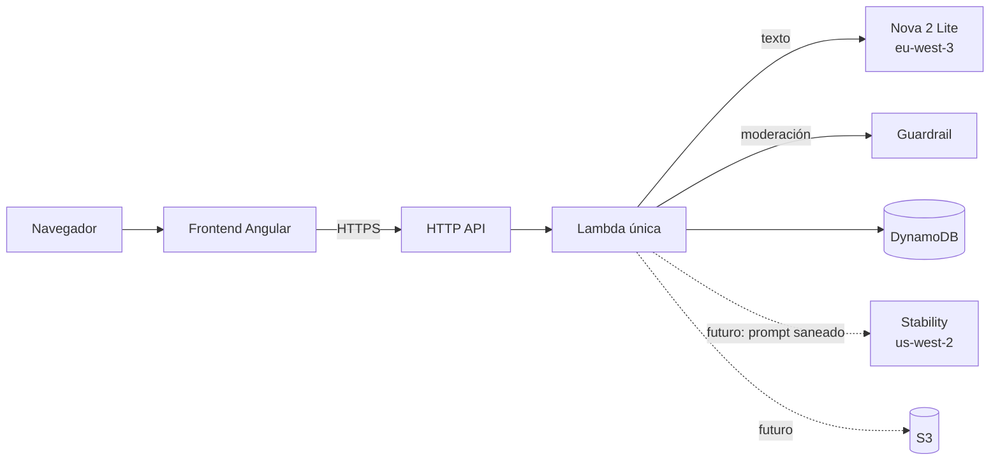
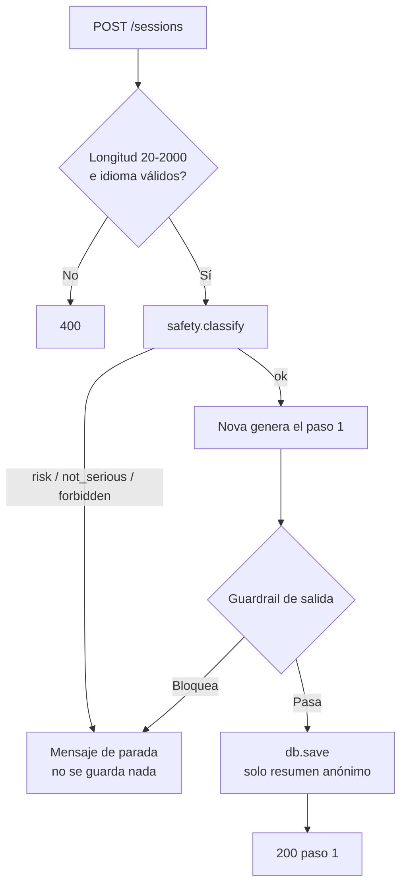

# Nightmare Resolver: documento técnico

Qué está construido, cómo funciona y por qué. Para el detalle del código, ver `docs/guia-codigo.md`. Las tareas están en `.kiro/specs/lucid/tasks.md`.

## 1. Estado

Leyenda: ✅ hecho y probado con tests · 🟡 programado, falta desplegar o probar en AWS · ⬜ sin empezar

| # | Funcionalidad | Backend | Infra (CDK) | Probado con AWS real |
|---|---|---|---|---|
| 1 | Estructura del proyecto y CI | ✅ | ✅ | No aplica |
| 2 | Modelos, cliente de Nova y prompts | ✅ | No aplica | 🟡 la versión anterior sí; hay que repetirlo tras la simplificación |
| 3 | Moderación (guardrail + clasificador) | ✅ | 🟡 guardrail definido | 🟡 |
| 4 | Motor de la historia y API | ✅ | 🟡 tabla, Lambda y API definidas | 🟡 |
| 5 | Imágenes (Stability) | ⬜ | ⬜ | ⬜ |
| 6 | Voz (Polly) | ⬜ | ⬜ | ⬜ |
| 7 | Galería pública | ⬜ | ⬜ | ⬜ |
| 8 | Alojamiento del frontend (S3 + CloudFront) y WAF | No aplica | 🟡 S3 + CloudFront definidos, sin WAF | ⬜ |
| 9 | Frontend | 🟡 historia de 5 pasos, moderación, ES/EN | No aplica | ⬜ |
| 10 | Pulido, README y vídeo | ⬜ | ⬜ | ⬜ |

**Despliegue:** la API se probó en `alarmaiot` (`eu-south-2`). El destino definitivo es `nightmare-prod` en `eu-west-3` (sección 7).

## 2. Visión general

| Carpeta | Qué es | Lenguaje |
|---|---|---|
| `frontend/` | La web | Angular (TypeScript) |
| `backend/` | La lógica: IA, moderación e historia. Una sola Lambda | Python 3.12 |
| `infra/` | Los recursos de AWS | Python (AWS CDK) |



Las líneas discontinuas aún no existen.

## 3. Conceptos básicos

- **Bedrock / Nova 2 Lite**: servicio de AWS y modelo de texto que usamos (`eu.amazon.nova-2-lite-v1:0`). El prefijo `eu.` deja que AWS atienda la petición en cualquier región europea, pero los datos no salen de Europa.
- **Converse**: la operación de Bedrock con la que hablamos con Nova.
- **Razonamiento extendido**: Nova "piensa" antes de responder. Más preciso, pero más caro y lento. Solo lo usamos en el paso de cierre.
- **Guardrail**: filtro de seguridad de Bedrock (sexual, violencia, odio, ataques al prompt y un tema `SelfHarm`).
- **Stability (Stable Image Core)**: modelo de imágenes, solo en `us-west-2`. Nunca recibe el texto original del usuario.
- **Lambda**: función que se ejecuta solo cuando se la llama.
- **CDK**: describe la infraestructura con Python. `cdk synth` genera la plantilla, `cdk deploy` crea los recursos y `cdk destroy` los borra.

## 4. Backend

### 4.1 Ficheros (`backend/src/nightmare/`)

| Fichero | Qué hace |
|---|---|
| `handler.py` | Entrada de la Lambda. Enruta por `routeKey` y traduce errores a HTTP |
| `story.py` | `start()` y `next_step()` |
| `ai.py` | `ask()`: llama a Nova y valida el JSON de respuesta |
| `safety.py` | Clasificación de la entrada y comprobación de la salida |
| `db.py` | Guardar, leer y borrar sesiones |
| `models.py` | Arco de 5 pasos, `Step`, `Session`, `Category`, `ApiError` |
| `prompts.py` | Instrucciones que se envían a Nova |
| `messages.py` | Textos y recursos de ayuda cuando se para la sesión |

No usa pydantic: los datos son `dataclasses` y `Step.from_dict` valida la respuesta del modelo. Así el zip de la Lambda es solo la carpeta `src`, sin dependencias ni Docker.

### 4.2 Flujo de una historia



`POST /sessions/{id}/steps`: carga la sesión, comprueba que la opción exista en el paso actual, genera el paso siguiente (el 5 con razonamiento extendido), lo pasa por el guardrail de salida y guarda. Si el guardrail bloquea, borra la sesión.

### 4.3 Moderación (`safety.py`)

1. Guardrail sobre la entrada. Si salta el tema `SelfHarm`, es `risk` sin más.
2. Clasificador de Nova: `ok`, `not_serious`, `forbidden_content` o `risk`. `risk` siempre gana.
3. Si el guardrail bloqueó y el clasificador no dijo `risk`, el resultado es `forbidden_content`.
4. Sin `GUARDRAIL_ID` configurado, el guardrail se omite (útil en local).

En una versión anterior se repetía la clasificación con razonamiento extendido antes de rechazar, y había una lista de palabras prohibidas para los prompts de imagen. Se quitaron por simplicidad. La lista se recuperará con las imágenes (tarea 5). Hay que comprobar con casos reales que no se rechazan pesadillas oscuras genuinas.

### 4.4 Errores

| Situación | Respuesta |
|---|---|
| Idioma, longitud, opción o body inválidos | 400 con `{"error": código}` |
| Sesión inexistente o caducada | 404 `session_not_found` |
| Sesión ya terminada | 409 `session_finished` |
| El modelo no devuelve un JSON válido tras un reintento | 502 `generation_failed` |
| Throttling de AWS | 429 `busy` |
| Otro error de AWS | 503 `unavailable` |
| Cualquier otro | 500 `internal`, sin detalles |

No se registran cuerpos de petición ni mensajes de excepción, porque pueden contener texto del usuario.

### 4.5 Privacidad

- El texto original solo vive en memoria durante la petición. Se guarda un resumen anónimo generado por Nova.
- Las sesiones caducan a las 24 h (campo `ttl`).
- Solo un prompt de imagen saneado saldrá de la UE (futuro).

## 5. Infraestructura (`infra/`)

### 5.1 Recursos (`stacks/nightmare_stack.py`)

| Recurso | Cantidad | Para qué |
|---|---|---|
| Guardrail y su versión | 1 + 1 | Moderación |
| Tabla DynamoDB | 1 | Sesiones, con TTL |
| Función Lambda | 1 | Toda la API |
| HTTP API, etapa, 2 rutas | 1 | Entrada desde Internet |

Decisiones:
- **ARM64, 512 MB, 29 s.** La HTTP API corta a los 30 s, y las llamadas a Bedrock tienen un límite de 20 s.
- **Límite global**: 5 peticiones por segundo con picos de 10. El límite por IP llegará con WAF (tarea 8).
- **CORS**: por defecto `http://localhost:4200`. Para otro origen: `cdk deploy -c allowedOrigins='["https://..."]'`.
- **La tabla se borra con `cdk destroy`.** Solo guarda sesiones temporales.
- **Tag** `application = nightmare` en toda la app (`infra/app.py`).

### 5.2 Permisos mínimos

| Permiso | Recurso |
|---|---|
| `bedrock:InvokeModel` | El perfil `eu.amazon.nova-2-lite-v1:0` y el modelo en regiones `eu-*` |
| `bedrock:ApplyGuardrail` | Solo nuestro guardrail |
| DynamoDB lectura y escritura | Solo la tabla de sesiones |

Como el permiso de Nova solo incluye regiones europeas, AWS rechazaría procesar el texto fuera de Europa.

### 5.3 Guardrail (`stacks/guardrail.py`)

| Filtro | Entrada | Salida | Motivo |
|---|---|---|---|
| Sexual | Alto | Alto | Nunca debe aparecer |
| Violencia | **Bajo** | Medio | Las pesadillas son violentas; el clasificador decide qué es gratuito |
| Odio | Alto | Alto | |
| Insultos | Medio | Alto | |
| Conducta indebida | Medio | Alto | |
| Ataque al prompt | Alto | No aplica | Solo tiene sentido en la entrada |

Además define el tema denegado `SelfHarm`. Su nombre debe coincidir con `SELF_HARM_TOPIC` en `backend/src/nightmare/safety.py`. CDK pasa el id y la versión del guardrail a la Lambda como variables de entorno.

### 5.4 Empaquetado

La Lambda se sube con `Code.from_asset("backend/src")`. No hay `pip install` ni Docker, porque boto3 ya viene en el entorno de Lambda. `cdk synth` y `cdk deploy` funcionan en cualquier equipo con Node y Python.

### 5.5 Regiones

| Región | Uso |
|---|---|
| `eu-west-3` (París) | Todo: Nova, guardrail, tabla, Lambda, API y bucket de la web |
| Global | CloudFront (sirve la web; la API se llama directamente en `eu-west-3`) |
| `us-west-2` (Oregón) | Solo imágenes (futuro). Nova Canvas dejó de existir el 30/09/2026 |

### 5.6 Coste

Todo es de pago por uso. Cada historia consume unas 6 llamadas a Nova 2 Lite (clasificación y 5 pasos) más las del guardrail. Como las llamadas a Nova ya no pasan por un perfil de inferencia de aplicación, **el gasto de Bedrock no se puede separar por tag**. Los demás recursos sí llevan `application = nightmare`. Si hace falta separar el gasto de Bedrock, se puede recuperar un perfil de aplicación.

## 6. Tests y calidad

| Archivo | Qué comprueba | ¿Llama a AWS? |
|---|---|---|
| `backend/tests/test_app.py` | Validación de `Step`, paradas de moderación, historia de 5 pasos, rutas y errores HTTP, que un paso inseguro borra la sesión | No (fakes) |
| `infra/tests/test_stack.py` | Una Lambda, rutas, TTL de la tabla, permisos de Bedrock, tema `SelfHarm`, CORS | No |
| `backend/tests/test_properties.py` | Tests basados en propiedades (Hypothesis): invariantes del arco de 5 pasos, límites de `Step`, ida y vuelta JSON de `Session`, recursos de ayuda solo en `risk` | No |
| `infra/tests/test_frontend_stack.py` | Bucket privado con OAC, CloudFront con HTTPS, CORS de la API con el dominio de CloudFront | No |
| `frontend/src/app/app.spec.ts` | Formulario, primer paso, elección, parada por riesgo con recursos, errores y reintento | No (HTTP simulado) |

Resultado actual: 23 tests de backend (8 de propiedades), 6 de infra y 5 de frontend pasan, y `cdk synth` termina sin errores.

```powershell
cd backend; .\.venv\Scripts\python.exe -m pytest -q
cd ..\infra; .\.venv\Scripts\python.exe -m pytest -q
$env:CDK_DEFAULT_REGION="eu-west-3"; npx aws-cdk@2.1148.1 synth
cd ..\frontend; npx ng test --watch=false
```

Automatismos:
- **CI en GitHub** (`.github/workflows/ci.yml`): lint y tests del backend, build del frontend, tests de infra y `cdk synth`.
- **Hook de Kiro** (`.kiro/hooks/backend-tests-on-save.json`): lanza los tests al guardar un `.py` del backend.

Pendiente: un corpus de entradas para evaluar el clasificador contra Nova real. El anterior (24 casos) se borró con la simplificación y está en el historial de git.

## 7. Despliegue

### 7.1 Destino

Cuenta **`nightmare-prod` (`639589055085`)**, creada para la app en la OU `nightmare` con `scripts/org-accounts.bat`. Región **`eu-west-3` (París)**. El código no depende de ninguna cuenta: CDK usa la del perfil con el que se despliega.

| Dato | Valor |
|---|---|
| Página SSO | `https://d-9067f1fd59.awsapps.com/start` |
| Región de IAM Identity Center | `us-east-1` |
| Usuario | `jllarreag2022` (`AdministratorAccess`) |
| Perfil | `nightmare-prod` (región `eu-west-3`) |
| Perfil de la cuenta de gestión | `jllarreag-2` (SSO) |

Para renovar la sesión: `aws sso login --sso-session jllarreag-sso`.

### 7.2 Por qué París y no España

En `nightmare-prod`, todas las cuotas de Bedrock en `eu-south-2` aparecían a 0 (también un día después), mientras que en `eu-west-3` tienen los valores por defecto (2000 peticiones/min y 8 M tokens/min para Nova 2 Lite). El perfil `eu.` funciona igual y los datos siguen en la UE. Mientras tanto se probó la API en `alarmaiot` (`eu-south-2`), que se destruye tras migrar.

### 7.3 Pasos

```powershell
aws sso login --sso-session jllarreag-sso
aws sts get-caller-identity --profile nightmare-prod
cd infra
.\.venv\Scripts\Activate.ps1
npx aws-cdk@2.1148.1 bootstrap aws://639589055085/eu-west-3 --profile nightmare-prod --tags application=nightmare   # una vez
npx aws-cdk@2.1148.1 deploy --all --profile nightmare-prod
cd ..
scripts\deploy-frontend.bat nightmare-prod
```

`deploy --all` crea `NightmareResolverWeb` (S3 + CloudFront) y `NightmareResolver` (API). El script del frontend compila la app, escribe `config.json` con la URL de la API, sube los ficheros y muestra la URL de CloudFront (añade `?debug` para ver las respuestas de la API). Para borrar todo: `npx aws-cdk@2.1148.1 destroy --all --profile nightmare-prod`.

Después del despliegue:
- Recorrer una historia completa llamando a la API real.
- Probar las cuatro rutas de moderación (`ok`, `not_serious`, `forbidden_content`, `risk`) con el guardrail activo.
- Confirmar que Nova responde con el perfil `eu.` en la región elegida, incluido el cierre con razonamiento extendido.

## 8. Decisiones

| Tema | Decisión | Motivo |
|---|---|---|
| Simplicidad | Una Lambda, funciones sueltas, sin inyección de dependencias | Es un hackatón: el código debe poder leerse de un tirón |
| Validación | `dataclasses` y `Step.from_dict`, sin pydantic | Sin dependencias, sin Docker, despliegue más simple |
| Modelo de texto | Nova 2 Lite | Barato, disponible en la UE, razonamiento opcional |
| Región | `eu-west-3` (París) | Cuotas de Bedrock disponibles en la cuenta nueva (7.2) |
| Web | S3 privado + CloudFront; la API se llama directamente | El texto de la pesadilla va del navegador a `eu-west-3` sin pasar por CloudFront |
| Modelo de imagen | Stable Image Core en `us-west-2` | Nova Canvas ya no existe |
| Imágenes | 2 (paso 1 y paso 4) | Coste, rapidez y contraste entre pesadilla y nuevo final |
| Privacidad | El texto original nunca sale de la UE | Solo viajará un prompt saneado |
| Concurrencia | Sin bloqueo optimista | Un doble clic en un hackatón no justifica la complejidad |
| Prompts | Instrucciones en inglés, respuesta en el idioma del usuario | Un solo juego que mantener |
| Angular | Versión 21 | Angular 22 exige Node 22.22.3 y hay 22.22.2 |

## 9. Pendiente

**Despliegue**
- [ ] Desplegar en `nightmare-prod` (`eu-west-3`), probar la web y la API real y evaluar el clasificador con el guardrail activo.
- [ ] Después, `cdk destroy --all --profile alarmaiot`.

**Revisiones menores**
- [ ] Comprobar que la CI pasa en GitHub Actions tras la simplificación.
- [ ] Revisar las 16 vulnerabilidades moderadas que avisa `npm install` en `frontend/`.
- [ ] Antes de la tarea 5: la cuota de Stable Image Core en `us-west-2` está a 0 en `nightmare-prod` (pedir aumento o elegir otra región de imágenes).

**Tareas del spec sin empezar**: 5 imágenes, 6 voz, 7 galería, 8 WAF y 10 pulido. El frontend (9) tiene la primera versión.

## 10. Glosario

| Término | Significado |
|---|---|
| Arco | La estructura fija de 5 pasos de la historia |
| IRT | Imagery Rehearsal Therapy: reescribir el final de la pesadilla y ensayarlo |
| Prompt | Texto de instrucciones que se envía a la IA |
| Inyección de prompt | Intento del usuario de dar órdenes a la IA mediante su texto |
| Stack | Conjunto de recursos de AWS gestionados juntos por CDK |
| TTL | Fecha de caducidad de una fila de DynamoDB; pasada esa fecha, se borra |
| CORS | Regla del navegador sobre qué webs pueden llamar a la API |
| SSO | Inicio de sesión único con credenciales temporales |
| Bootstrap | Preparación que CDK necesita una vez por cuenta y región |
